<p align="center">
  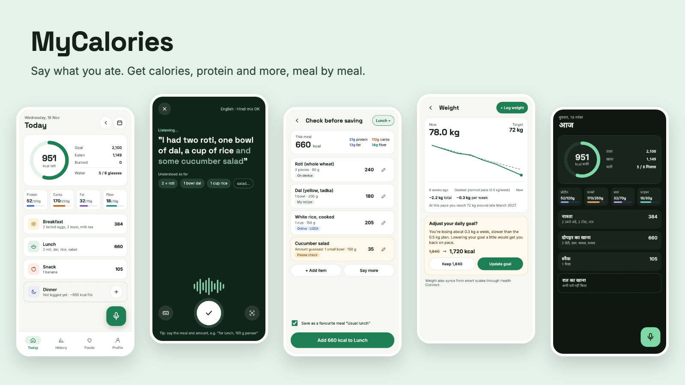
</p>

<h1 align="center">MyCalories</h1>

<p align="center">
  <b>Say what you ate. The app does the counting.</b><br>
  An Android calorie tracker you talk to, built for Indian home food.
</p>

<p align="center">
  
  
  
  
  
</p>

---

## How it works

Tap the mic and say something like *"two roti, a bowl of dal and some salad for lunch"*.

1. **It listens.** Your words appear as you speak. Mixed English and Hindi is fine.
2. **It understands.** Each food, how much you had, and which meal it was. If you don't say the meal, it asks and suggests one by the time of day.
3. **It checks with you.** You see every food with its calories before anything is saved, and can fix any amount in a tap.
4. **It remembers.** Foods are saved on your phone, so the next time is instant and works offline.

<p align="center">
  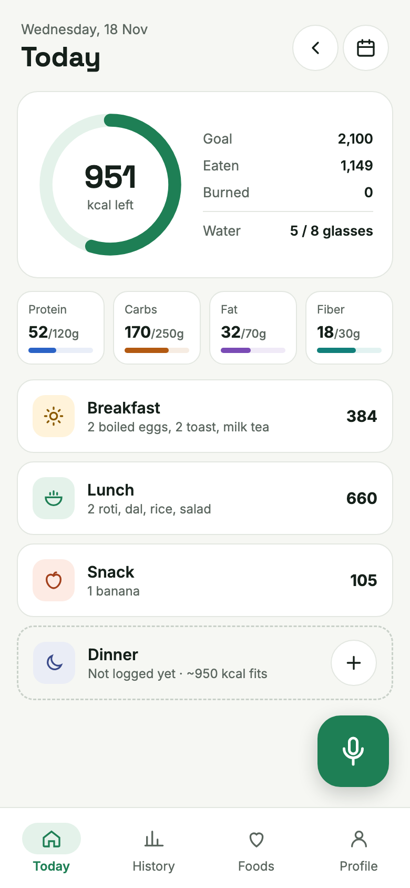
  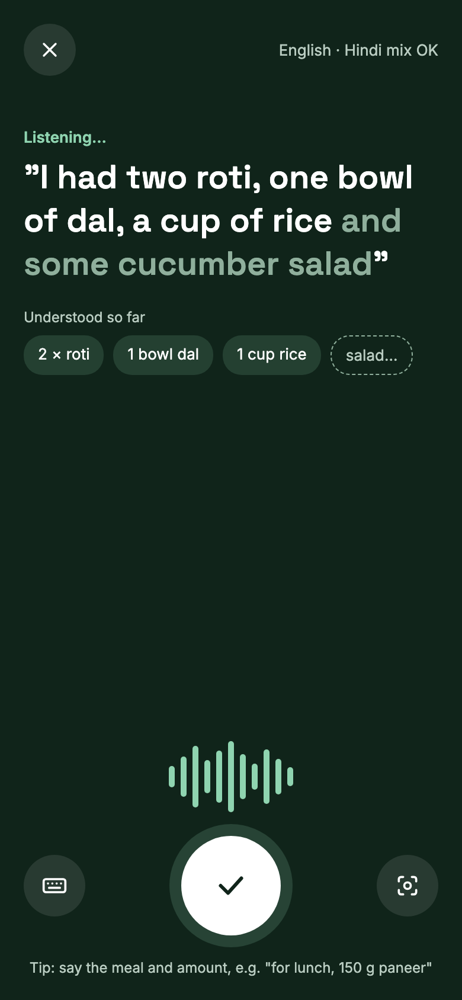
  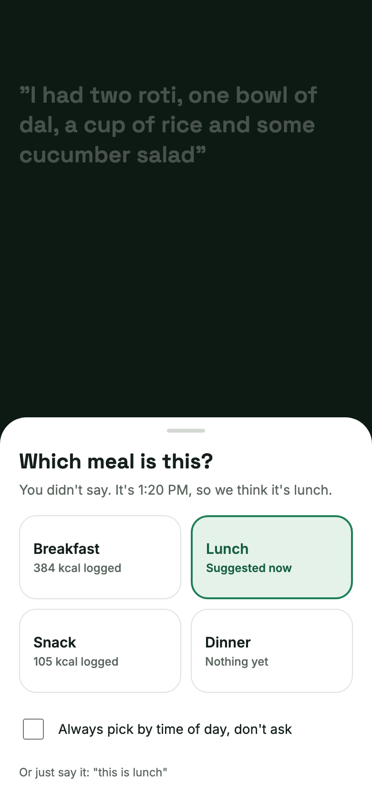
  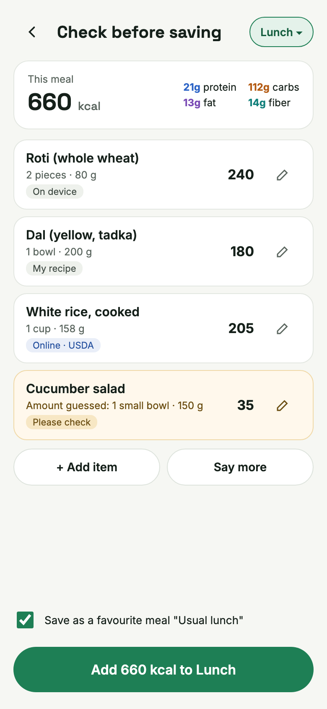
  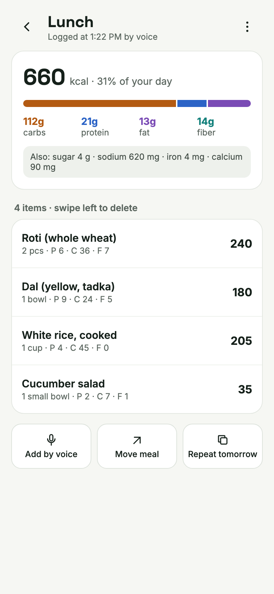
</p>

## Features

### Log food your way

| | |
|---|---|
| 🎙️ **Voice** | Speak naturally, in English or Hindi |
| 📷 **Plate photo** | Snap your plate and the foods are recognised |
| 🔎 **Barcode** | Scan a packet for its label nutrition |
| ⌨️ **Typing** | When speaking isn't convenient |
| 🍲 **Recipes by voice** | Say the ingredients once and get per-bowl nutrition |
| ⭐ **Favourites** | Log your usual lunch in one tap, or copy yesterday |

<p align="center">
  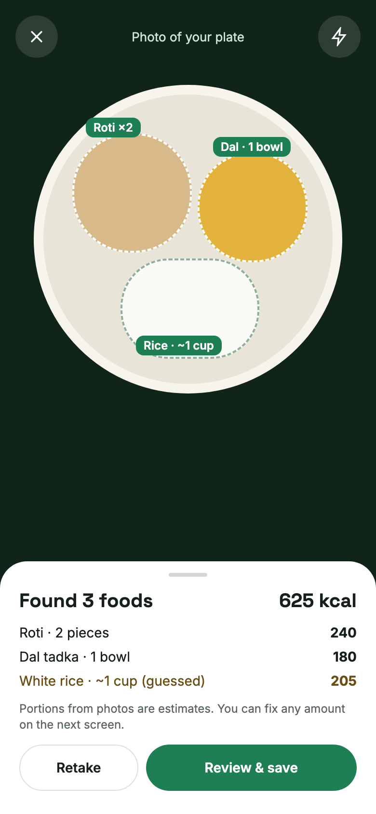
  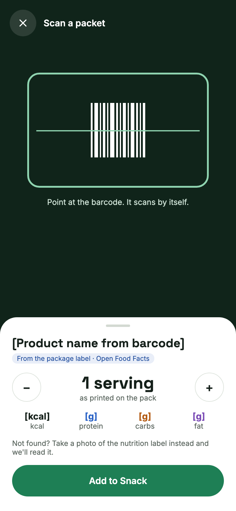
  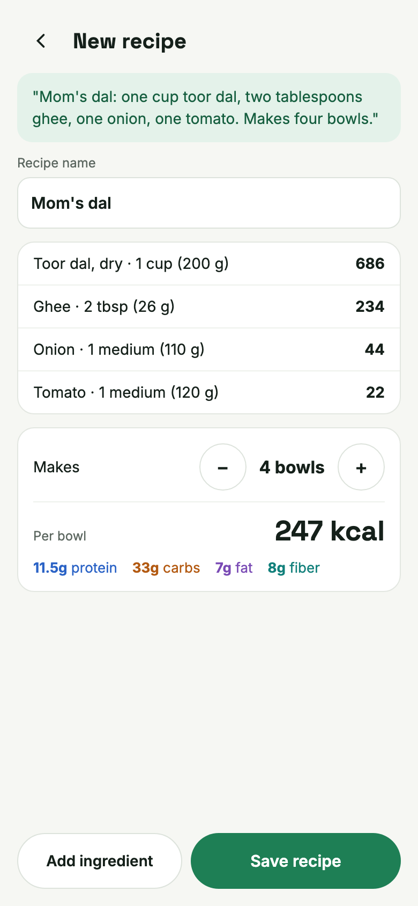
  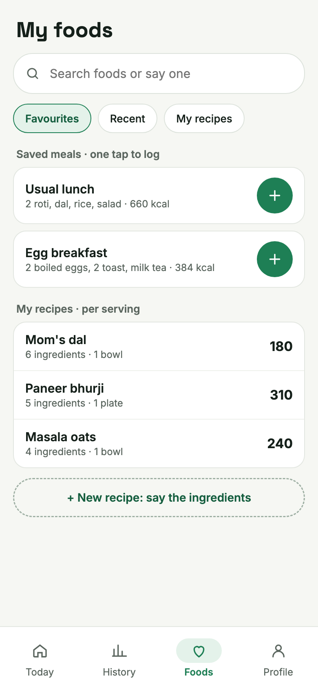
  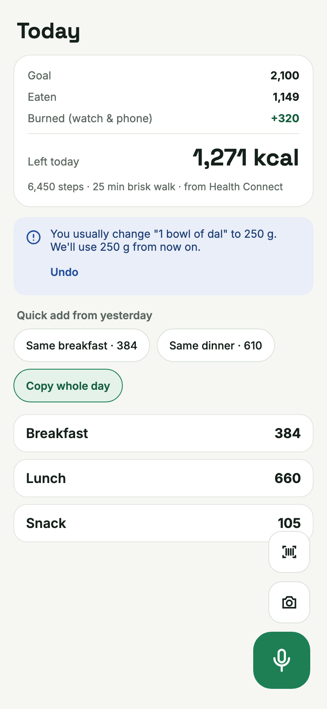
</p>

### Understand what you eat

- **Calories, protein, carbs, fat and fiber** for every meal and every day
- **Vitamins and minerals:** iron, calcium, B12, vitamin D, vitamin C, potassium and sodium, with foods that help
- **Weekly summary** with what went well and simple, Indian-food tips for what to improve
- **Weight trend** that suggests a gentle change to your goal when progress is off plan
- **Ask** questions such as *"What should I eat for dinner to hit my protein?"*

<p align="center">
  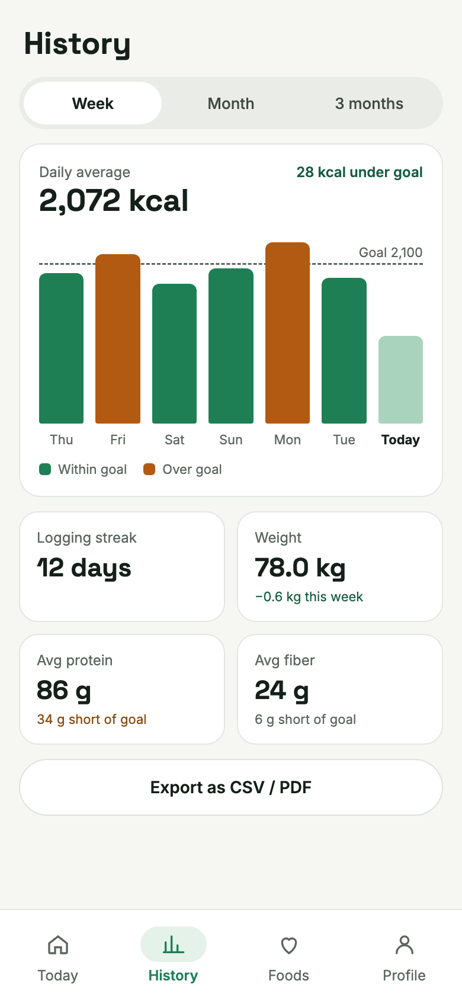
  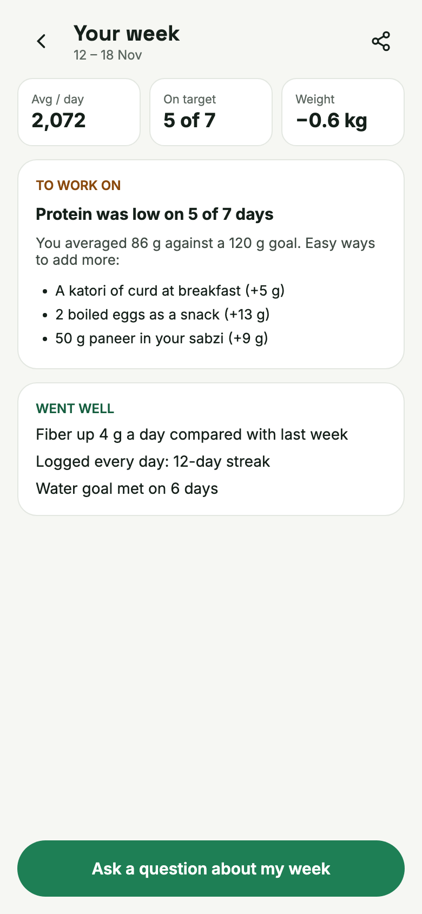
  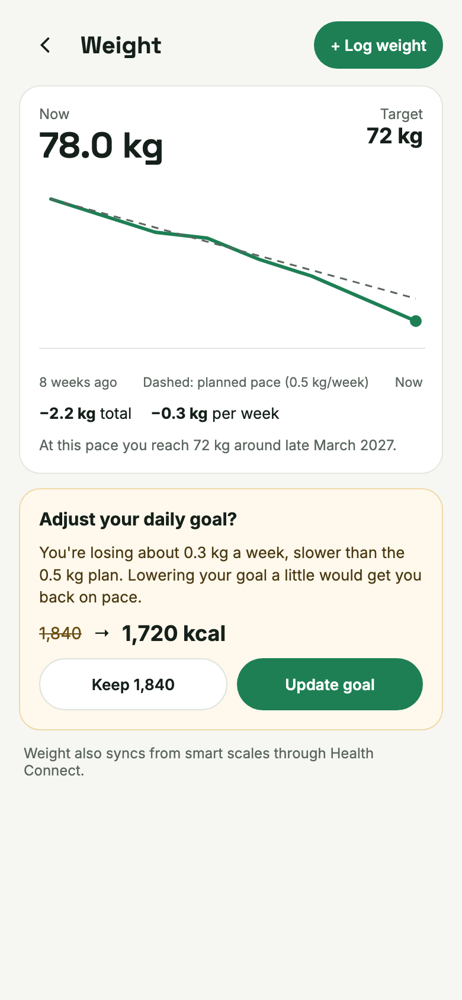
  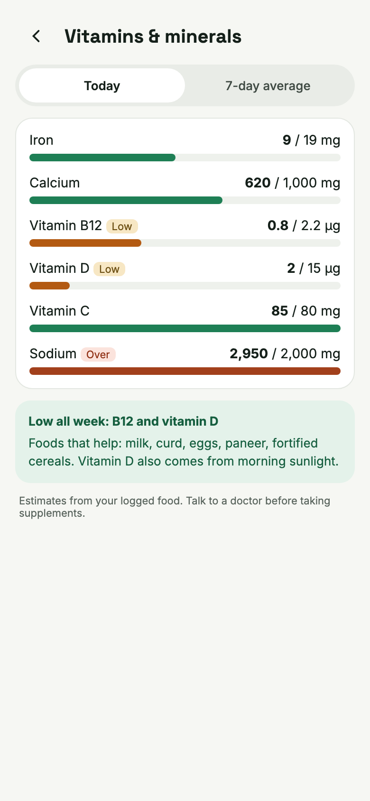
  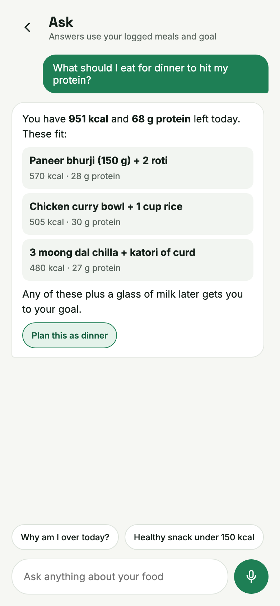
</p>

### Made for everyday life

- **Smart portions:** correct "1 bowl" to 250 g twice and it uses your bowl size from then on
- **Reminders** at your usual meal times, plus water reminders
- **Home-screen widget** with calories left and a one-tap mic
- **Health Connect:** steps and workouts add to what you can eat; weight from smart scales
- **English and Hindi**, light and dark themes
- **Your data stays yours:** export to PDF or CSV, back up, restore, or delete everything

<p align="center">
  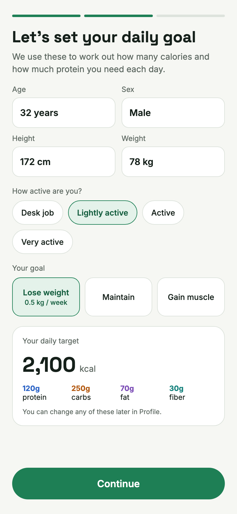
  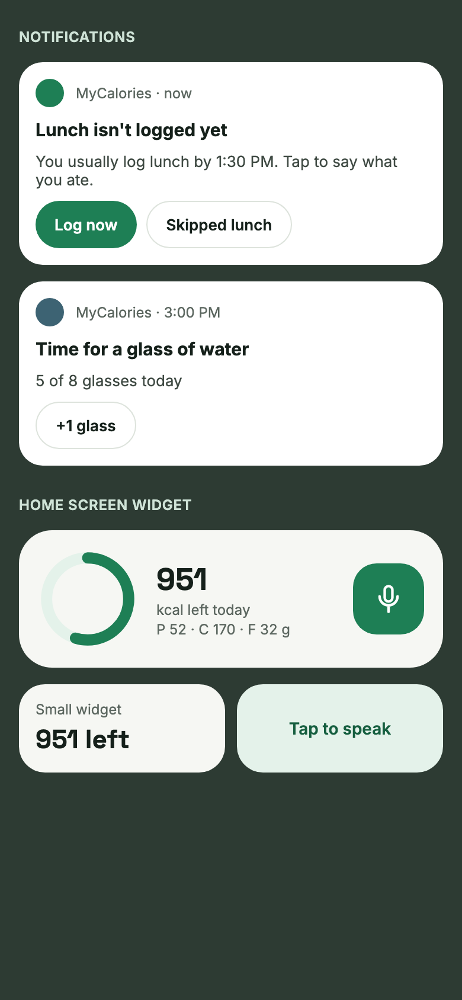
  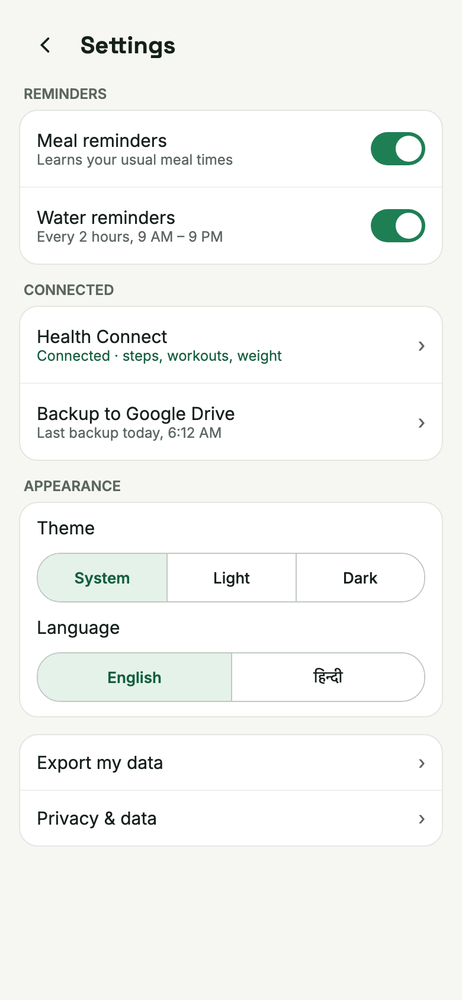
  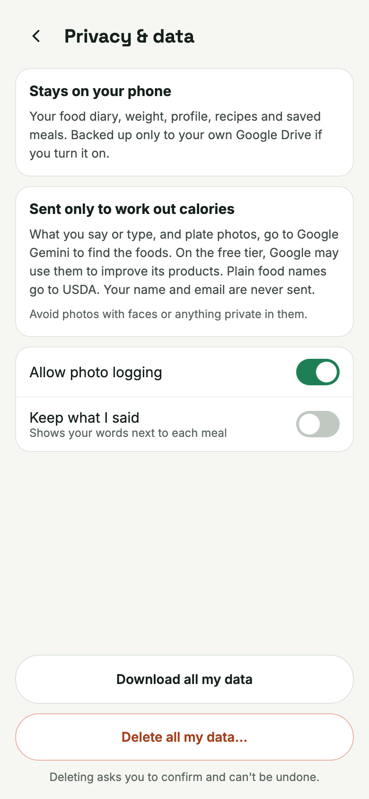
  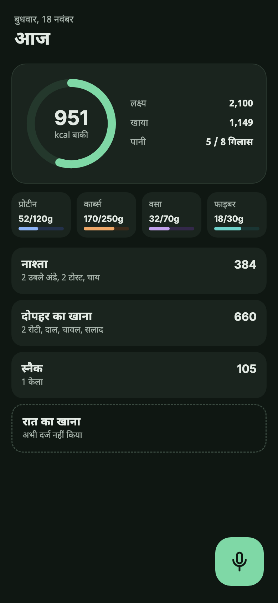
</p>

> Screens above are from the app's design. The built app follows them closely, with small layout differences.

---

## Get started

**You need:** Android Studio, and an Android phone or emulator running Android 8.0 or newer.

1. **Clone and open** the project in Android Studio.
   ```bash
   git clone https://github.com/chandanklc/MyCalories.git
   ```
2. **Get a free Gemini API key** at [aistudio.google.com](https://aistudio.google.com) → **Get API key** → **Create API key**.
3. **Add the key** to `local.properties` in the project folder. This file stays on your computer and is never committed.
   ```properties
   GEMINI_API_KEY=your-key-here
   ```
4. **Sync Gradle and press Run.**

<details>
<summary><b>Optional settings</b></summary>

| Setting in `local.properties` | What it does |
|---|---|
| `GEMINI_MODEL` | Use a different Gemini model (default `gemini-3.5-flash-lite`, with `gemini-3.8-flash` as backup) |
| `USDA_API_KEY` | Your own key for USDA food lookups (a shared demo key is used otherwise) |
| `ANTHROPIC_API_KEY` | Use Claude instead of Gemini (paid) |

</details>

> **Privacy note:** on Gemini's free tier, Google may use what you send (food descriptions and plate photos) to improve its products. Your food diary itself stays on your phone.

<details>
<summary><b>Signed release build</b></summary>

Release builds are signed from `keystore.properties` in the project folder. That file and the `keystore/` folder are never committed.

```properties
storeFile=keystore/mycalories-release.jks
storePassword=...
keyAlias=mycalories
keyPassword=...
```

Then build:

```bash
./gradlew :app:assembleRelease :app:bundleRelease
```

You get `app/build/outputs/apk/release/app-release.apk` (to install directly) and `app/build/outputs/bundle/release/app-release.aab` (for Google Play). Without `keystore.properties`, release builds are left unsigned.

</details>

---

## How it's built

| Layer | What's inside |
|---|---|
| **UI** | Jetpack Compose with Material 3, one ViewModel per screen (MVVM) |
| **Domain** | Plain Kotlin: goal calculator, portions, meal-time guessing, insights, weight trend |
| **Data** | Room database, DataStore settings, Gemini client, USDA and Open Food Facts lookups |
| **Platform** | Speech recognition, camera, barcode scanner, Health Connect, WorkManager reminders, Glance widget |

```
app/src/main/java/com/example/mycalories/
├── ui/          screens and ViewModels
├── domain/      models and rules (no Android code)
├── data/        database, settings and online services
├── platform/    Android features: health, reminders, widget, camera
└── voice/       speech to text
```

### Tests

Written test-first: domain rules, database and migrations, network clients, every ViewModel and the main screens. They run on your computer, no phone needed.

```bash
./gradlew :app:testDebugUnitTest
```

---

<p align="center">Made with care for everyday Indian meals.</p>
